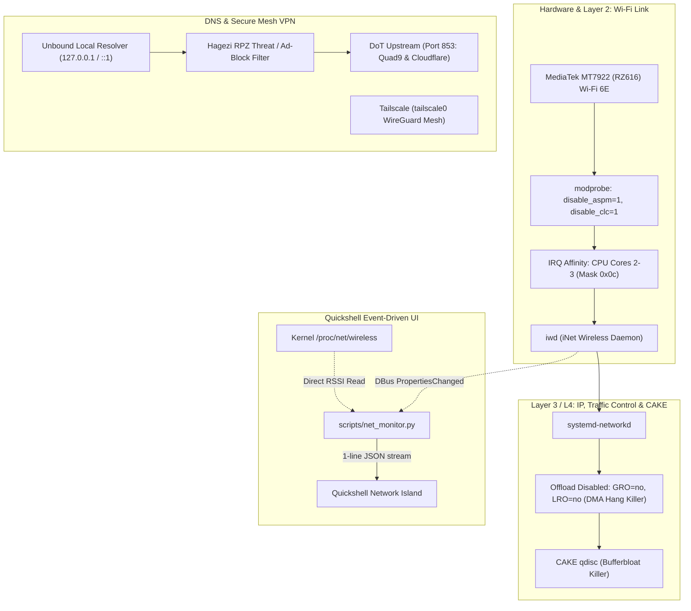

# Network Stack Architecture & Operations Manual

This document details the multi-layered network architecture, hardware stabilization rules (especially for MediaTek MT7922), traffic control, and operational procedures for this system.

---

## 1. System Topology: Complete Separation of Concerns

Monolithic tools like NetworkManager are completely eliminated. The network stack is divided into dedicated, lightweight layers with zero background polling:



---

## 2. Hardware Survival Shield: Taming the MediaTek MT7922

The MediaTek MT7922 (RZ616) Wi-Fi 6E chipset is notorious in the Linux kernel community for DMA buffer hangs and firmware crash loops upon sleep/idle recovery. This system applies a hardened defense matrix:

### 1. Disabling GRO / LRO (`/etc/systemd/network/10-wifi.link`)
```ini
GenericReceiveOffload=no
LargeReceiveOffload=no
```
- **Why this is critical**:
  When Generic Receive Offload (GRO) aggregates packets in kernel memory, MT7922's scatter-gather DMA descriptors frequently desynchronize under burst traffic, causing the firmware to freeze ("fall asleep"). Disabling GRO/LRO feeds packets immediately to the network stack, completely preventing firmware DMA hangs.

### 2. Disabling PCIe ASPM & CLC (`/etc/modprobe.d/mt7921e.conf`, `mt7921.conf`)
```ini
options mt7921e disable_aspm=1
options mt7921_common disable_clc=1
```
- **Why?**:
  - `disable_aspm=1`: Disables Active State Power Management. Prevents PCIe bus latency and sleep-wake kernel panic.
  - `disable_clc=1`: Disables Carrier Location Code throttling to avoid unexpected transmit power degradation.

### 3. IRQ Affinity to CPU Cores 2-3 (`/etc/modprobe.d/mt7921e-affinity.conf`)
```bash
/usr/local/bin/set-wifi-irq.sh  # Sets /proc/irq/<irq>/smp_affinity_list -> 2-3
```
- **Why?**:
  Binds hardware interrupt handling of Wi-Fi packets to isolated CPU cores 2 and 3 (mask `0x0c`), preventing network interrupts from causing micro-stuttering on CPU cores 0 and 1 (where single-core latency-critical tasks run).

---

## 3. High-Fidelity DNS Stack: Unbound + DoT + Hagezi RPZ

Unlike conventional setups that rely on `systemd-resolved`, this system bypasses resolved completely:

```
[ Application ] 
       │ (Direct query)
       ▼
[ /etc/resolv.conf ] -> 127.0.0.1 / ::1
       │
       ▼
[ Unbound Resolver ] (Local Cache on loopback)
       │
       ├──> [ Hagezi RPZ Filter ] (Malware, SPAM TLDs, Tracker blocker)
       │
       └──> [ DNS-over-TLS (DoT: 853) ] -> Quad9 (9.9.9.9) & Cloudflare (1.1.1.1)
```

- **`systemd-resolved`**: Disabled. No double-lookup latency, no caching conflicts.
- **Privacy & Security**: Every query leaving the machine is encrypted via TLS on port 853.
- **Threat Protection**: Unbound checks local RPZ response policy zones before forwarding queries, blocking phishing and telemetry domains at the DNS level.

---

## 4. Layer 2 & 3 Traffic Control Tuning

### Layer 2: `iwd` (`/etc/iwd/main.conf`)
- `EnableNetworkConfiguration=false`: Pure association only; IP configuration delegated to `systemd-networkd`.
- `PowerSave=off`: Zero packet dropping from Wi-Fi sleep.
- `DisableScanning=true`: Eliminates periodic background scan lag spikes during online games or VoIP.
- `BandModifier5G=1.5 / 6G=2.0`: Forces aggressive priority for 5GHz and 6GHz channels.

### Layer 3/4: `systemd-networkd` & Kernel Sysctl
- **CAKE (`TCQDisc=cake`)**: Eliminates bufferbloat; ping remains flat even under full 1Gbps download/upload saturation.
- **MTU 1454 (`MTUBytes=1454`)**: Prevents packet fragmentation on Japanese FTTH / PPPoE encapsulation.
- **NDP Reachable Time (300 seconds)**: Extended from default 30s to 300s (`net.ipv6.neigh.wlan0.base_reachable_time_ms = 300000`), slashing unnecessary NDP multicast discovery broadcasts over Wi-Fi airwaves.
- **TCP BBR + Lowat**: Uses `tcp_congestion_control = bbr` with `tcp_notsent_lowat = 20480` to minimize sender bufferbloat.

---

## 5. Quickshell UI Monitoring (`scripts/net_monitor.py`)

1. **Wired Operstate**: Reads `/sys/class/net/en*/operstate`.
2. **Wi-Fi Association**: Subscribes to DBus `net.connman.iwd` (`PropertiesChanged` signal). Instant notification on AP handoff.
3. **RSSI (Signal)**: Reads `/proc/net/wireless` directly from the kernel. No subshells, zero idle CPU.
4. **Stream**: Pipes single-line JSON (`{"wired": false, "connected": true, ...}`) to Quickshell's `SplitParser`.

---

## 6. Emergency Runbook (CLI Cheat Sheet)

### 1. Wi-Fi (`iwctl`)
```bash
# Connect to Wi-Fi
iwctl station wlan0 scan
iwctl station wlan0 get-networks
iwctl station wlan0 connect "<SSID>"

# Disconnect / Forget
iwctl station wlan0 disconnect
iwctl known-networks "<SSID>" forget
```

### 2. Network State & Renewal (`networkctl`)
```bash
# Check IP and link state
networkctl status wlan0

# Force DHCP renew & reconfigure
networkctl reconfigure wlan0
```

### 3. DNS Testing (Unbound)
```bash
# Verify local Unbound DoT resolution
drill @127.0.0.1 google.com
# or
dig @127.0.0.1 google.com
```

### 4. Tailscale Remote Access
```bash
tailscale status
tailscale ping <node-name>
```
